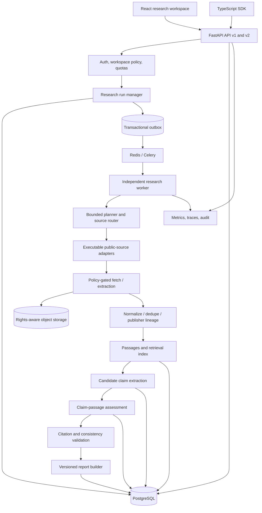
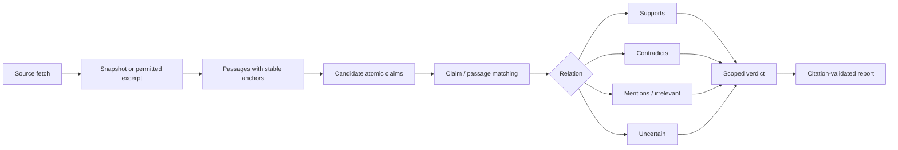
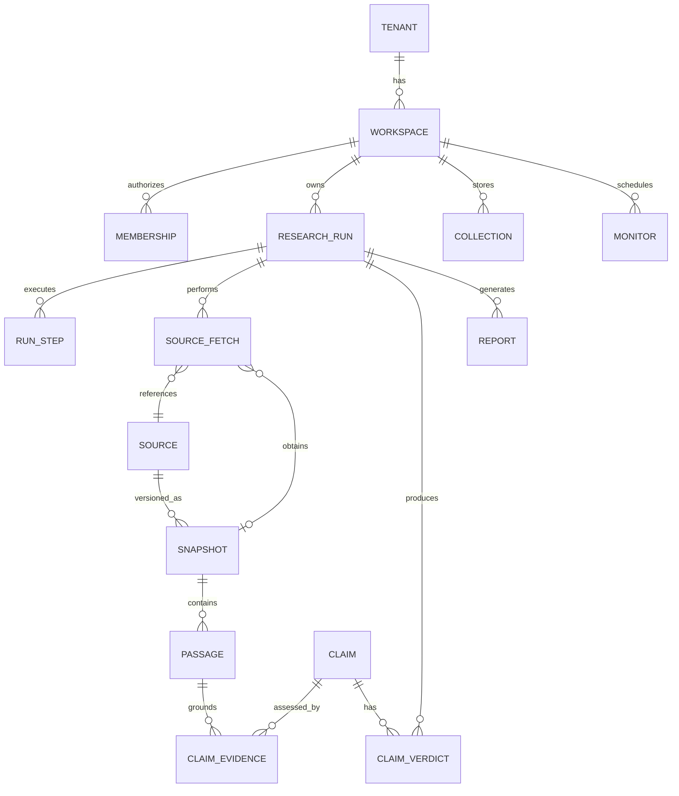

# CredenceAI

> **Open Evidence Intelligence Infrastructure**  
> **Discover. Verify. Understand. Decide.**

**Document:** Project definition, product requirements, and architecture specification  
**Version:** 2.0 (proposed)  
**Updated:** 14 October 2026  
**Status:** Architecture and delivery plan; **not** a claim that v2 features are shipped  
**License:** MIT (existing project)  
**Repository:** https://github.com/Niruuu2005/CredenceAI  
**Web application:** https://credence-ai-gamma.vercel.app  
**API documentation:** https://credenceai-api.onrender.com/docs

---

## 1. Executive summary

**CredenceAI** is an open-source, evidence-first research platform that discovers information across web, news, scholarly, and structured knowledge sources; preserves source provenance; assesses what specific evidence supports or contradicts; and generates auditable research briefs.

The existing MVP combines a FastAPI backend, a React/TypeScript frontend, a TypeScript SDK, search adapters, job processing, source scoring, deduplication, entity resolution, and research workspaces. **CredenceAI 2.0** strengthens this foundation by making *claims and their supporting passages* the central data model rather than treating ranked URLs or AI-generated summaries as verified findings.

### Product promise

A researcher can ask a question or submit a factual claim, inspect the exact source passages relevant to it, distinguish supporting and contradictory evidence, see important coverage gaps, and export a versioned report whose material statements are traceable to evidence.

**We do not promise to determine universal truth.** A finding can be *supported by the evidence examined*, *disputed*, *insufficiently supported*, or *not assessed*. CredenceAI makes the basis for that judgment inspectable.

### Strategic focus

- **Initial users:** student research groups, campus fact-checking teams, community newsrooms, and small NGOs.
- **Primary job-to-be-done:** verify and explain an important public claim without the expense or manual overhead of enterprise research tools.
- **Core differentiation:** open/self-hostable research workflows, passage-level provenance, source-independence analysis, transparent uncertainty, and reproducible reports.
- **Architecture choice:** modular monolith with durable background workers, not premature microservices.
- **Business direction:** free-first core; optional paid hosting, organizational workflows, and institutional deployment after product validation.

## 2. Problem statement

Research is fragmented across web search, scholarly indexes, news archives, and knowledge graphs. Even when AI systems cite sources, a cited URL may not substantiate the specific statement made. Repeated reporting can be mistaken for independent confirmation, and users often cannot reproduce how a conclusion was reached.

This creates four practical problems:

1. **Discovery friction:** relevant materials are spread across incompatible services.
2. **Evidence ambiguity:** retrieval, relevance, authority, and factual support are often collapsed into one opaque score.
3. **Provenance loss:** snippets and generated reports omit stable passages, versions, and retrieval context.
4. **Access inequality:** small teams cannot always afford proprietary, high-touch research infrastructure.

**Opportunity:** provide a transparent, affordable process that converts retrieved material into *inspectable evidence*, not merely fluent answers.

### 2.1 How CredenceAI works in simple words

CredenceAI is a **high-trust evidence intelligence engine** that doesn't just search the web, but also verifies the information it finds to make sure it is accurate, safe, and organized:

1. **Submit an inquiry:** You ask a question (e.g., *"Did clean energy investments surpass fossil fuels globally in 2024?"*) via the Research Studio or API.
2. **Intent classification:** The engine determines what research domain you are exploring (empirical facts, breaking news, scholarly literature, or corporate filings).
3. **Multi-facet planning:** The AI Planner breaks your inquiry into verifiable atomic propositions and determines optimal knowledge sources (Wikidata, Wikipedia, Crossref, OpenAlex, news syndication).
4. **Governed acquisition:** Crawlers check robots.txt, enforce strict SSRF protections against internal IPs, and respect rate limits.
5. **Raw snapshot preservation:** Content is archived in immutable storage with cryptographic SHA-256 hashes so findings remain permanently auditable.
6. **Normalization & quality scoring:** Boilerplate, ads, and navigation clutter are stripped away. Source reliability, freshness, and substantive content are calibrated.
7. **Deduplication & entity resolution:** Syndicated AP/Reuters reprints are grouped so duplicate coverage isn't mistaken for independent corroboration. Entities are grounded against Wikidata identifiers.
8. **Evidence grounding & frozen reporting:** The system links atomic claims to specific text passages via typed relations (`supports`, `refutes`, `contradicts`, `insufficient_evidence`) and compiles an immutable brief with frozen citations.

## 3. Users and use cases

| User | Main task | Valuable output |
|---|---|---|
| Student or early-career researcher | Investigate a public or academic question | Cited brief, relevant papers, limitations |
| Campus/community fact-checker | Assess a factual assertion | Claim-to-passage evidence and disputed points |
| Journalist or small newsroom | Cross-check a developing story | Source lineage, dates, contradiction map |
| NGO research team | Study public policies or local issues | Shareable evidence report, repeatable monitoring |
| Developer or analyst | Add provenance-aware retrieval to a workflow | Typed API/SDK and structured evidence export |

**Launch wedge:** prioritize a complete workflow for student/campus and community fact-checking teams. Do not optimize simultaneously for enterprise intelligence, general chat, web automation, and research literature reviews.

### Representative scenario

A campus research group asks: *"What evidence supports the claim that a local education policy increased attendance?"*

CredenceAI retrieves the policy, relevant public statistics, studies, and reporting; distinguishes the implementation date from publication dates; highlights passages that discuss actual attendance measurements; identifies limitations in before-and-after comparisons; and produces a brief stating what is supported, what remains uncertain, and which sources are primary or derivative.

## 4. Product positioning and principles

**Category:** research and evidence intelligence platform.  
**One-line positioning:** *An open-source workspace for researching, cross-checking, and auditing claims across multiple information sources.*

### Product principles

1. **Provenance by construction.** Evidence keeps publisher, original URL, retrieval time, permitted snapshot/excerpt, and exact passage reference.
2. **No confidence theater.** Ranking scores are not described as probabilities of factual truth.
3. **Evidence before prose.** Generate reports from linked claims and passages, then validate citations.
4. **Source independence matters.** Five syndications of one story do not equal five independent confirmations.
5. **Transparent abstention.** Return insufficient evidence when sources cannot substantiate a claim.
6. **Human review is first class.** Users can annotate assessments without rewriting the underlying evidence.
7. **Free-first and policy-aware.** Run with enabled, executable adapters; respect upstream terms, robots policies, rate limits, and retention rights.
8. **Security is a data-model constraint.** Ownership and tenant permissions apply to APIs, database queries, indexes, caches, and exports.
9. **Incremental architecture.** Extend current code through versioned contracts and migrations, not an avoidable rewrite.
10. **Measure before scaling.** Adopt vector search, graph databases, and service decomposition only in response to demonstrated requirements.

## 5. Goals, non-goals, and success criteria

### Goals (v2 MVP)

- Run multi-source research with explicit adapter execution and source-coverage reporting.
- Save reproducible document metadata and rights-permitted snapshots or excerpts.
- Extract atomic claims and link them to exact, accessible passages.
- Label evidence relationships as `supports`, `contradicts`, `mentions`, `irrelevant`, or `uncertain`.
- Return run-scoped verdicts: `supported`, `disputed`, `insufficient_evidence`, or `not_assessed`.
- Produce a versioned, citation-validated report and basic export.
- Provide a side-by-side evidence inspector, human review, and collections.
- Enforce organization/workspace isolation throughout retrieval and storage.
- Benchmark quality, cost, reliability, and time-to-brief against human-labeled examples.

### Explicit non-goals for initial release

- Automatically declaring a disputed claim objectively true or false in all contexts.
- Unbounded autonomous agents, arbitrary browsing actions, or long-horizon autonomous operations.
- A standalone graph database, microservice fleet, Kafka, or globally replicated infrastructure.
- Paid search subscriptions as dependencies for the default experience.
- Enterprise connectors, SSO, procurement analytics, or full compliance certifications on day one.
- Training a proprietary foundation model.

### North-star and supporting metrics

**North-star:** percentage of completed research tasks producing a *useful, human-reviewed, evidence-traceable* brief.

Track evidence attribution accuracy, unsupported-claim rate, citation integrity, research time saved, independent-source coverage, cost per completed run, user corrections, repeat usage, and partial/failure rates. Targets in Section 16 are **proposed release gates**, not achieved results.

## 6. Product experience

### Research modes

| User mode | Legacy correspondence | Scope | Output | Important caveat |
|---|---|---|---|---|
| **Discover** | `fast` | Lightweight federated search | Diverse ranked sources, metadata | No verified-claim label |
| **Investigate** | `standard` | Selective retrieval, passages, evidence checking | Claim-evidence table, cited brief | May abstain |
| **Deep Investigation** | `deep` | Broader coverage, additional full-text analysis | More comprehensive evidence map, frozen report | Not guaranteed to resolve conflict |
| **Monitor** | Existing monitors | Scheduled reproducible reruns | Deltas, new/removed/changed evidence | Only checks at configured times |

Preserve legacy API mode values where needed; introduce clear v2 product semantics without silently breaking SDK consumers.

### Core workflow

1. User chooses a workspace, poses a question or claim, and optionally selects time, location, languages, source classes, and budget.
2. System creates a durable `research_run` and plans bounded subqueries.
3. Source router selects **enabled and executable** adapters with adequate coverage, health, and quotas.
4. Adapters retrieve metadata and eligible content with explicit policy checks.
5. Pipeline normalizes and deduplicates data, recording publisher lineage and fetch context.
6. System extracts passages, atomic claims, and entity/time/quantity scope.
7. Evidence assessor proposes relationships; deterministic validators check citation existence, quoted spans, and structured consistency.
8. User inspects findings and uncertainty, optionally accepts or annotates assessment items.
9. Report builder creates a versioned, auditable brief with links to evidence snapshots.
10. Collections and monitors preserve research and allow later comparison.

### Primary screens

- **Research home:** question entry, modes, filters, budgets, and recent runs.
- **Run progress:** actual stages, provider coverage, partial failures, and cancellation.
- **Findings board:** atomic claims grouped by assessment status and importance.
- **Evidence inspector:** claim, highlighted passage, source metadata, independence group, limits, and reviewer notes.
- **Source explorer:** primary/secondary/aggregator identification and syndication relationships.
- **Report workspace:** citations, version information, export, share controls, and approval.
- **Monitors & collections:** saved evidence, scheduled investigations, and change history.
- **Settings:** workspace membership, API keys, quotas, retention, provider configuration.

### 6.4 UI/UX architecture & 3-palette theme system

The CredenceAI user interface balances an authoritative editorial aesthetic with modern, accessible interaction design:

- **Curated 3-Theme System:**
  1. **Dark Theme:** Rich ink-black/charcoal canvas (`#0a0a0a`), stone-gray panels (`#121212`), high-contrast text (`#e5e5e5`), and emerald trust accents (`#10b981`).
  2. **Light Theme:** Alabaster warm-white paper canvas (`#fbfbf9`), crisp card panels (`#ffffff`), deep charcoal typography (`#1c1c1a`), and deep teal brand accents (`#0f766e`).
  3. **Beige Theme (Light Sand & Warm Brown):** Soft light beige canvas (`#faf6ed`), normal beige panels (`#f3ebd9`), rich warm brown borders (`rgba(139, 90, 43, 0.22)`), deep espresso typography (`#26180d` / `#4d3725`), and warm brown accents (`#8b5a2b`).
- **Editorial Brutalist Typography:**
  - *Headings:* `Instrument Serif` (italicized) for archival, literary gravitas.
  - *Metadata & Stats:* `JetBrains Mono` for confidence ratings, hashes, timestamps, and citation IDs.
  - *Body Text:* `General Sans` (neo-grotesque) for high-legibility report reading.
- **Responsive Navigation:**
  - Full desktop sidebar with usage gauges and account status.
  - Automatic sliding drawer layout for viewports `< 1024px` with a 44px touch-target mobile hamburger header.
  - Zero unhandled modal interrupts; styled Radix dialogs replace browser `window.confirm` and `window.prompt`.
- **Accessibility (WCAG AA):**
  - High-contrast card text across all light/dark/beige modes.
  - Visible keyboard focus rings (`focus-visible:ring-2`).
  - Screen-reader accessible attributes (`aria-hidden` on Lucide icons, descriptive form labels).

## 7. System architecture

**Style:** modular monolith (FastAPI application with strict module boundaries) plus independent durable workers and a scheduler. PostgreSQL is the canonical source of truth. Indexes and caches are reconstructable projections.



### Module boundaries

| Module | Owns | Does not own |
|---|---|---|
| Identity & Access | User, tenant, workspace, RBAC, credentials | Claim verdicts |
| Research Runs | Lifecycles, budgets, step history, idempotency, outbox | Direct network fetches |
| Source Intelligence | Adapter contracts, capabilities, routing, provider health | Invented/unavailable source support |
| Acquisition | Network policy, crawling, raw payload reference, snapshots | Factual accuracy decisions |
| Content & Retrieval | Normalization, dedupe, passages, indexes, publisher lineage | User permissions policy decisions |
| Evidence Engine | Claims, passage-level relationships, run-scoped verdicts | External account mutations |
| Reports | Evidence-bound synthesis, citation checks, versions, export | Unverified factual assertions |
| Monitoring | Scheduled reruns and evidence deltas | Silent mutation of historical reports |
| Operations | Audit logs, budgets, metrics, tests | Storage of plaintext secrets |

### Technology decisions

| Concern | Default choice | Upgrade only if measured need arises |
|---|---|---|
| API | FastAPI + Pydantic | Split services if isolation/scale demands it |
| Frontend | React + Vite + TypeScript + Tailwind | Additional clients via SDK |
| Database | PostgreSQL (SQLite for local demos/tests) | Partition high-volume tables |
| Background jobs | Celery + Redis + separate worker | Separate retrieval/verification worker pools |
| Snapshots & reports | S3-compatible object storage | Content-addressed archival tiers |
| Search | PostgreSQL full-text search | pgvector hybrid; OpenSearch at high scale |
| Model access | Provider-independent interface with opt-in AI | Multiple providers subject to cost and policy |
| Authentication | OIDC/OAuth, scoped hashed API keys | Campus SSO once justified |
| Tracing/metrics | OpenTelemetry + structured logs | Managed aggregation when needed |
| Deployment | Vercel frontend; stateless API, DB, queue, worker, object storage | Multi-region only after a validated requirement |

## 8. Retrieval and source adapters

### Existing and intended source classes

| Source class | Initial candidates | Role |
|---|---|---|
| Web | SearXNG, DuckDuckGo | General discovery |
| Reference | Wikipedia, Wikidata | Background and canonical entities |
| News | GDELT | Article discovery and event coverage |
| Scholarly | OpenAlex, Crossref, arXiv | Research discovery and bibliographic metadata |
| Archive | Common Crawl | Historical retrieval where permissible |

**Important:** adapter availability, production credentials, provider health, license/terms, and actual executability must be checked at runtime. Metadata indexes and aggregators are *discovery channels*, not automatically independent publishers or fact validators.

### Adapter contract

Each adapter declares a `manifest` and implements a typed `search()` operation:

```python
class AdapterManifest:
    id: str
    version: str
    enabled: bool
    executable: bool
    source_class: str
    supported_verticals: list[str]
    capabilities: list[str]       # search, metadata, full_text, historical
    languages: list[str]
    rate_limit: dict
    timeout_seconds: float
    cost_class: str
    legal_constraints: list[str]

class SearchRequest:
    run_id: str
    query: str
    filters: dict
    deadline_seconds: float
    result_limit: int

class SearchResponse:
    adapter_id: str
    fetched_at: str
    raw_payload_ref: str | None
    normalized_hits: list[dict]
    latency_ms: float
    error: str | None
    coverage_notes: list[str]
```

*Illustrative interface, not drop-in Python implementation.*

The router must validate enabled/executable status; match task, geography, language, freshness, provider quotas, and policy; distribute a fixed budget; run adapters with timeouts and bounded concurrency; and record why adapters were skipped or failed. Partial failures must be reflected in the report.

## 9. Evidence engine (core differentiator)

### Evidence pipeline



### Source and snapshot provenance

For each retained item, capture where permitted:

- Retrieval adapter, original publisher, original URL, canonical URL, and source type.
- Fetched timestamp **separately** from publication date; date confidence when available.
- Content hash, immutable `snapshot_id`, extraction method/version, language, and content rights.
- Passage `snapshot_id`, text offset/anchor, and hash. Preserve the exact passage used in the assessment within applicable rights.
- Relationships indicating quotation, syndication, original reporting, or common upstream source.

### Atomic claim model

Represent subject, predicate, object/value, units, geography, population, time scope, conditions, wording, extractor/version, and provenance. A claim made by a user is distinguishable from a claim extracted from source material.

**Example:** `Attendance increased by 8% in District A during 2025` cannot be compared fairly with `Attendance increased by 5% in District A during 2024` without reconciling baselines, units, and time scope.

### Claim-passage relationship

Each `claim_evidence` association stores:

- `claim_id` and `passage_id`.
- `relation`: `supports`, `contradicts`, `mentions`, `irrelevant`, or `uncertain`.
- Assessor type/model/rule version and evidence explanation.
- Temporal/geographic/numeric checks.
- Source-independence group and primary/secondary attribution.
- Human review state, reviewer, timestamp, and optional rationale.

An NLI model or constrained LLM may **propose** a relationship. Deterministic checks verify accessible citation IDs, actual passages, quote spans, numerical and temporal consistency wherever feasible. Flag inconclusive or high-impact conflicts for review.

### Run-scoped verdicts

| Verdict | Meaning |
|---|---|
| `supported` | Available relevant evidence supports the scoped claim without unresolved material contradiction within the assessed set |
| `disputed` | Material evidence conflicts or credible sources make incompatible scoped claims |
| `insufficient_evidence` | Retrieved accessible evidence cannot support a defensible conclusion |
| `not_assessed` | The system did not complete verification, or the claim was outside scope/budget |

Always phrase conclusions as **"supported by evidence examined"**, not universally established fact. Do not infer falsehood from missing evidence. Do not display a probability-of-truth score until externally calibrated and documented.

### Report validation contract

1. Generate a structured draft from approved claim/evidence references.
2. Split it into material factual statements.
3. Require each material statement to resolve to authorized `passage_id` references in the frozen run.
4. Check cited passages and relations against the claim; flag unsupported figures, incompatible dates, or missing citations.
5. Preserve disagreements and missing coverage in the final narrative.
6. Block or revise unsupported statements; never silently replace the raw evidence or reviewer history.
7. Persist a versioned report plus source-manifest hash and evaluation/config versions.

A valid citation **link** is necessary but not sufficient. Human-labeled evaluations must measure whether the cited passage truly supports the associated assertion.

## 10. Data model and persistence

### Core relationships



### Primary tables

| Table | Key fields and constraints |
|---|---|
| `tenants`, `workspaces`, `memberships` | Membership roles, tenant IDs, unique role membership tuples |
| `research_runs` | Workspace, user, query, mode, status, budgets, config hash, version, timestamps |
| `run_steps` | Run, step, attempt, idempotency key, status, duration, typed error |
| `source_fetches` | Run, adapter, provider request, status, latency, raw payload reference, coverage |
| `sources` | Canonical identifier, original publisher, source class, terms/rights |
| `snapshots` | Source, fetched/published times, SHA-256, object ref, rights/retention, immutable version |
| `passages` | Snapshot, offset/anchor, passage hash/text, extraction version |
| `claims` | Proposition, entities, units, temporal and geographic scope, extraction origin |
| `claim_evidence` | Claim, passage, relation, rationale, method version, review state |
| `claim_verdicts` | Run, claim, verdict, evidence summary, evaluation version, timestamp |
| `reports` | Run, version, manifest hash, body reference, reviewer/status |
| `outbox_events` | Event ID, type, aggregate ID, payload, dispatch status |
| `audit_events` | Tenant, actor, action, resource, timestamp, minimal safe context |

Continue supporting existing `users`, `jobs`, `normalized_results`, `quality_scores`, `collections`, `monitors`, `api_keys`, and related data through non-breaking migrations and adapters. Do **not** discard historic research jobs during v2 migration.

### Tenancy and shared knowledge

- Every private object is scoped to a workspace and checked against a server-derived `AuthContext`.
- Database repository methods require tenant/workspace context; consider PostgreSQL row-level security as additional defense.
- Public rights-cleared corpora use a separate explicit namespace rather than leaking into personal indexes.
- Cache and index entries include access scope; a cache hit must not bypass authorization.
- Retention, deletion, shared exports, and backup lifecycle are documented and tested.

## 11. Durable orchestration and reliability

### Lifecycle

```text
created -> queued -> planning -> retrieving -> extracting -> normalizing
        -> verifying -> reporting -> completed
                                  -> partial
At any active stage: -> failed | cancelled | timed_out
```

- Use transactionally recorded run creation plus an **outbox event** published to Celery after commit.
- Assume at-least-once task delivery; make handlers idempotent by `(run_id, step_key, input_version)`.
- Use safe state transitions, worker lease/claim logic, bounded retries, exponential backoff and jitter.
- Persist provider errors independently; a research run can complete as `partial` with coverage warnings.
- Apply hard per-run budgets for time, providers, pages, bytes, and AI tokens/cost.
- Provide cancellation checkpoints and recovery of stalled tasks without duplicate outputs.
- Keep high-latency research jobs out of the HTTP process in production.

### Cache model

Do not key research caches by normalized query text alone. Include query/filter signature, workspace or rights scope, source configuration, retrieval/evaluator version, and freshness window. Revalidate authorization on every hit. Document TTLs by source type, and invalidate derived summaries when claim-evaluation rules change.

### Search/index model

PostgreSQL is authoritative; search indexes are derived views with asynchronous indexing and rebuild capability. Use full-text retrieval first; introduce semantic retrieval only when benchmarked improvement exceeds the complexity and operating cost. Index records must carry access filters.

## 12. API and SDK contracts

Preserve v1 endpoints where possible. Add v2 resources with explicit lifecycle and provenance.

```http
POST /api/v2/research-runs
GET  /api/v2/research-runs/{run_id}
GET  /api/v2/research-runs/{run_id}/sources
GET  /api/v2/research-runs/{run_id}/claims
GET  /api/v2/research-runs/{run_id}/claims/{claim_id}/evidence
GET  /api/v2/research-runs/{run_id}/reports/{version}
POST /api/v2/research-runs/{run_id}/reviews
POST /api/v2/research-runs/{run_id}/cancel
POST /api/v2/monitors
GET  /api/v2/monitors/{monitor_id}/deltas
```

### Example: create a research run

```json
{
  "workspace_id": "ws_demo",
  "question": "What evidence supports the claim that a local policy increased school attendance?",
  "mode": "investigate",
  "filters": {
    "languages": ["en"],
    "source_classes": ["official", "research", "news"]
  },
  "budget": {
    "max_sources": 12,
    "max_full_documents": 6,
    "max_seconds": 120
  },
  "idempotency_key": "policy-attendance-2026-10-14"
}
```

### Example: evidence assessment

```json
{
  "claim_id": "clm_123",
  "claim": "Attendance increased after the policy launch",
  "verdict": "insufficient_evidence",
  "supporting_evidence": [],
  "contradicting_evidence": [],
  "limitations": ["No primary before-and-after attendance data found"],
  "last_checked_at": "2026-10-14T10:00:00Z",
  "evaluation_version": "evidence-v2.0"
}
```

**API rules:** explicit 401/403/404 distinctions; safe pagination and limits; typed error codes; idempotent creation; consistent authorization; separate report retrieval from job-status polling; resumable UI updates via polling initially (SSE optional); SDK support for asynchronous runs and evidence models.

## 13. Security, safety, privacy, and legal constraints

### Identity and authorization

- Enforce authentication at ingress and authorization in shared data-access helpers.
- Scope API keys, jobs, saved sources, indexes, reports, exports, collections, and caches.
- Test malicious and accidental cross-tenant read/write attempts across every search backend.
- Hash/rotate/revoke tokens; never expose raw API keys again after creation.
- Encrypt transport and storage; configure secret management, backups, deletion and retention controls.
- Separate public shared datasets from private workspace data.

### Crawling and external content

- Permit only HTTP(S) network schemes, with validated DNS resolutions and connect-time IP enforcement.
- Block loopback, private/link-local, cloud metadata and other reserved destinations.
- Re-check every redirect; defend against DNS rebinding and decompression/oversized-document attacks.
- Apply robots rules, provider terms, domain rate limits, content-type and byte ceilings.
- Use constrained, minimally privileged extraction workers; do not pass service secrets to document parsers.
- Respect copyright and licensing; store full text only where retention is allowed.

### Model safety

- Treat retrieved content as **untrusted data**. Webpages cannot change instructions, tool permissions, tenant scope, or internal policy.
- Validate tools and outputs against strict schemas; apply model-token and iteration budgets.
- Log model/rule versions while minimizing sensitive user content in telemetry.
- Escalate contested, high-impact, or unresolvable findings for human review.
- Do not market the tool as certified for medical, legal, financial, or regulatory decision-making without dedicated evaluation and controls.

## 14. Observability and cost engineering

Every research run should record `run_id`, `workspace_id` (not sensitive user details), trace/correlation ID, current stage, provider coverage, step duration, cache hits, token usage, approximate cost, retry count, and errors.

Track:

- **Operations:** queue age, p50/p95 stage latency, completion/partial/failure rates, worker saturation, provider outage/rate-limit rates.
- **Quality:** passage attribution, citation validity, claim/evidence classification, source independence, user corrections.
- **Economics:** cost/run, bytes retrieved, adapter calls, AI tokens, storage growth, egress.
- **Product:** successful briefs, repeat researchers, saved/shared reports, time saved against baseline.

Emit traces through API → outbox → worker → adapter → verifier → report; audit review actions separately from debug logs.

## 15. Delivery roadmap

| Phase | Indicative window | Deliverables | Exit criterion |
|---|---|---|---|
| **0. Secure and make claims honest** | Weeks 1–2 | Tenant-scoped search/cache, remove fixed synthesis confidence, auth regression tests, secure index config | No known cross-tenant retrieval in tested paths; no false verified labels |
| **1. Correct retrieval execution** | Weeks 3–4 | Real capability router driving adapters, bounded parallelism, coverage diagnostics, durable workers | Three executable source classes observed on suitable integration tests |
| **2. Passage evidence MVP** | Weeks 5–8 | Snapshots/excerpts, passages, atomic claims, evidence relationships, citation gate, evidence inspector | Every material report claim has an inspectable authorized passage or uncertainty label |
| **3. Evaluation and pilot** | Weeks 9–12 | Labeled evaluation dataset, source-lineage checks, user pilots, benchmark/cost results, monitor deltas | Demonstrated task value and transparent evidence-quality results |

**These are planning horizons, not delivery guarantees.** Complete each exit gate before widening scope.

### First engineering sprint (prioritized)

1. Add required workspace/tenant scope to `/search` and all database/OpenSearch search functions.
2. Add cross-tenant tests for search, query cache, generated reports, and job results.
3. Stop using `final_trust_score` or hardcoded synthesis confidence as truth claims in public UI.
4. Define `SourceAdapter` protocol and select adapters from actual executable implementation registry.
5. Replace direct fixed-provider orchestration with real multi-source dispatch and explicit coverage reporting.
6. Introduce `research_runs` and `run_steps` v2 tables with idempotent migrations and state contract.

## 16. Quality benchmarks and acceptance criteria

Build an initial **100–200-question** human-labeled benchmark spanning normal, contested, stale, unknown-answer, geographic/temporal ambiguity, repeated/syndicated sources, and malicious content. Have at least two reviewers annotate a subset and adjudicate disagreements. Freeze input fixtures and version evaluation outputs.

| Measure | Proposed acceptance target, not current result |
|---|---|
| Cross-tenant isolation | Zero known unauthorized retrieval in adversarial tests |
| Citation resolution | 100% of report citations resolve to an authorized frozen passage ID |
| Passage-support accuracy | At least 95% of cited material statements supported by cited passages in held-out human review |
| Unsupported material claims | At most 5% in reviewed generated reports initially; improve thereafter |
| Claim relation classifier | Publish per-class precision/recall and confusion matrix |
| Source independence | Measure against hand-labeled original/syndicated pairs; set gate after baseline |
| Reproducibility | Frozen inputs and rule/model version produce explainable stable outputs or log nondeterminism |
| Execution budgets | Enforce page/source/time/byte/token ceilings with documented tolerance |
| Reliability | Record and trend completion, partial and failed runs plus stage p95 latency |
| User value | Show actual time-to-brief and correction rate compared with manual workflow |

### Test pyramid

- **Unit:** normalization, dedupe, passage offsets, scope matching, citation checks, permissions, budget logic.
- **Integration:** real adapter response fixtures, Postgres ACL, object storage, retries, outbox, index rebuild.
- **End-to-end:** research request to frozen report, partial providers, cancellation, rerun, review, export.
- **Security:** tenant leaks, cache poisoning, SSRF redirects, malicious retrieved text, API-key scopes.
- **Evaluation:** human-labeled source attribution, contradiction classification, abstention and calibration if scores are later introduced.
- **Load/resilience:** concurrent organizations, slow providers, worker loss, burst queues, object-storage failure.

## 17. Open-source, adoption, and sustainability

### Adoption strategy

Start with university and small community research teams. Offer reproducible sample investigations, a straightforward self-host guide, clear provider requirements, and an accessible free tier. Recruit small pilots and observe whether people can validate a claim faster and more accurately than their current workflow.

### Possible monetization (later)

- Free/MIT self-hosted core and limited hosted research.
- Hosted team workspaces, larger quotas, scheduled monitoring, and managed operations.
- Institution-focused support, deployment, training, and compliance-adjacent workflow features, without claiming certification.

Avoid choosing pricing or enterprise feature commitments until query economics, operating costs, and willingness to pay have been tested.

## 18. Risks and mitigations

| Risk | Impact | Mitigation |
|---|---|---|
| Cited passage does not support generated claim | High | Passage-level validation, held-out audits, abstention |
| Cross-tenant data exposure | Critical | Mandatory scoping at DB/index/cache, adversarial integration tests |
| Misleading source authority heuristics | High | Separate retrieval ranking from evidence support; publish limitations |
| Repeated stories appear independently corroborated | High | Original-publisher and syndication-lineage grouping |
| Source API rate limiting or outage | Medium–High | Budgets, retries, partial outputs, health-aware routing |
| Unsafe URL fetching / SSRF | Critical | Redirect-safe destination controls and restricted network execution |
| Copyright, robots or retention violations | High | Rights-aware storage, terms checks, permissible excerpts only |
| Prompt injection in retrieved text | High | Untrusted-data treatment, constrained tools, schema checks |
| In-process worker loss / repeated execution | High | Durable queues, idempotency, step leasing, reconciliation |
| Feature sprawl and operating cost | High | Launch wedge, MVP gates, capped providers/model usage |
| Low user retention despite feature breadth | Medium | Task-focused pilots, time-saved and correction metrics |

## 19. Repository implementation map

| Current area | v2 action |
|---|---|
| `backend/src/app/services/orchestrator.py` | Stage-based orchestration; adapter routing controls real fetches |
| `backend/src/app/agents/source_selection_agent.py` | Source choices derived only from executable manifests |
| `backend/src/app/services/quality_scorer.py` | Separate ranking/reliability heuristics from verification outcomes |
| `backend/src/app/services/evidence_graph.py` | Replace transient exact-text graph assumptions with versioned claim/passage links |
| `backend/src/app/services/synthesis.py` | Evidence-bound generation and deterministic citation checking |
| `backend/src/app/services/search_index.py` | Enforce tenant visibility across Postgres and OpenSearch paths |
| `backend/src/app/services/crawl_policy.py` | Redirect/DNS-resistant SSRF handling and rights-aware crawling |
| `backend/src/app/services/job_dispatch.py` | Durable queue-only production dispatch; eager dev mode |
| `backend/src/app/worker.py` | Idempotent run steps, retry policy, leases, partial outcomes |
| `backend/src/app/models.py` | Non-breaking workspace, run, snapshot, passage, evidence and report migrations |
| `backend/src/app/services/benchmark_runner.py` | Replace placeholder cases with labeled real-world benchmarks |
| `frontend/` | Evidence inspector, source lineage, review queue, versioned reports |
| `sdk/` | Typed v2 research run, claims/evidence, reviews, monitor deltas |
| `docs/` | Source manifests, operating runbooks, API schema, threats, evaluation protocol |

### Proposed internal package structure

```text
backend/src/app/
  api/v2/             # Versioned research, evidence, report endpoints
  identity/           # Auth context, permissions, workspace policies
  research/           # Run lifecycle, planner, steps, budgets
  sources/            # Adapter protocol, registry, routing, source lineage
  acquisition/        # Robots/SSRF, fetch, storage, extraction
  content/            # Normalization, dedupe, passages, retrieval
  evidence/           # Claims, claim_evidence, scoped verdicts
  reporting/          # Evidence-bound synthesis, citations, export
  monitoring/         # Reruns, deltas, alerts
  infrastructure/     # DB, broker, object storage, tracing
  models/             # Database entities and migration helpers
```

This is a **refactoring target**, not the repository's existing directory structure. Move functionality gradually behind compatible interfaces.

## 20. Architecture decisions

- **ADR-001:** Modular monolith plus durable workers, not microservices at launch.
- **ADR-002:** PostgreSQL is authoritative; search indexes and caches are rebuildable.
- **ADR-003:** Relational claim-to-passage edges before a dedicated graph database.
- **ADR-004:** Trust/ranking scores must not imply calibrated factual probability.
- **ADR-005:** Only enabled, available, executable, policy-compatible adapters can run.
- **ADR-006:** Authorization context is mandatory in retrieval, caching, reports, and exports.
- **ADR-007:** External content/model output is untrusted; deterministic guards cannot be overridden.
- **ADR-008:** Every report references a frozen, versioned evidence manifest.
- **ADR-009:** Introduce new model/index technologies only after benchmarked improvement.
- **ADR-010:** Maintain backward-compatible v1 endpoints during v2 migration.

## 21. Current implementation vs target

**Reported existing MVP:** FastAPI application and job API, React SPA, TypeScript SDK, public-source adapters, deterministic scoring/deduplication, entity linking, monitors, collections, deployment scripts, and tests. The repository also includes agent-related services and an improvement tracker. This is based on the original project description and a sampled repository review; it is **not** a complete production verification.

**Observed gaps motivating v2:** the sampled core orchestrator uses direct SearXNG retrieval even though a source-selection agent exists; cached scores and LLM synthesis include fixed/default confidence values; claim-evidence tracking relies heavily on matching normalized text; the inspected benchmark runner uses only two placeholder cases; and inspected search paths lack explicit workspace scoping. These are prioritized review findings, not an assertion that all production paths are unsafe or unavailable.

**Proposed, not yet verified as implemented:** immutable snapshot-plus-passage records, run-scoped claim verdicts, citation gate, independent publisher lineage, v2 workspace access model, durable outbox, and evidence-oriented report UI.

## 22. Demo narrative (IEEE / campus pilots)

1. Enter a public research question with clearly defined geography and timeframe.
2. Show that three executable source classes were queried, or explain unavailable providers.
3. Open a central claim and inspect a highlighted source passage.
4. Contrast an independently supporting source with repeated/derivative coverage.
5. Demonstrate either a genuine contradiction or an honest `insufficient_evidence` verdict.
6. Export a frozen report with source snapshots, retrieval dates, and visible limitations.
7. Present measured research time, citation-support accuracy, and cost per run rather than unsupported accuracy percentages.

## 23. External references and related project documents

- Original project repository: https://github.com/Niruuu2005/CredenceAI
- Core documentation files in `docs/`:
  - [`srs.md`](srs.md): Software Requirements Specification (functional, technical, and data design)
  - [`brd.md`](brd.md): Business Requirements Document (value proposition, personas, public impact)
  - [`architecture.md`](architecture.md): System Architecture, Technical Stack, and Deployment Runbooks
  - [`checklist.md`](checklist.md): 100% Completion & Release Acceptance Checklist
- Standards:
  - W3C Provenance Vocabulary (PROV-O): https://www.w3.org/TR/prov-o/
  - OWASP Top 10 for LLM Applications: https://owasp.org/www-project-top-10-for-large-language-model-applications/
  - NIST AI Risk Management Framework: https://www.nist.gov/publications/artificial-intelligence-risk-management-framework-generative-artificial-intelligence
  - OpenTelemetry Standards: https://opentelemetry.io/docs/

## 24. Master changelog & platform milestones

### Version 2.0.0 — Epistemic Evidence Intelligence (Current Release)
- **Research Studio v2:** Dedicated factual inquiry workspace with 5-stage live execution (`planning` → `retrieving` → `extracting` → `verifying` → `reporting`).
- **Resilient Fallback Engine:** Client-side zero-downtime execution engine (`researchFallback.ts`) ensuring flawless local and offline operation when cloud APIs are sleeping or cold-starting.
- **3-Palette Theme System:** Dark, Light, and Beige (soft light beige canvas `#faf6ed`, normal beige panels `#f3ebd9`, warm brown borders `rgba(139, 90, 43, 0.22)`, and espresso typography).
- **Public Guest Access:** Frictionless exploration via `user_public_guest` workspace; no mandatory login wall for public inquiry auditing.
- **Automated Keep-Alive:** Randomized 40–45s inactivity keep-alive heartbeat loop preventing free-tier cloud sleep.

### Version 0.6.1 — Deployment Hardening & Isolation
- **Dependency Fix:** Added `email-validator` for enterprise API validation (`EmailStr`).
- **Idempotent DB Migrations:** Platform completion migrations hardened for zero-downtime recovery on PostgreSQL.
- **Adversarial Security Tests:** Gated mock auth bypass to `APP_ENV=local` only; multi-tenant workspace isolation verified.

### Version 0.6.0 — Platform Completion & Agent Scaffolding
- **Agent Orchestrator:** Wired `AgentOrchestrator`, `AgentWorkingMemory`, and specialized agents (`CrawlStrategy`, `Experiment`, `OpsRecovery`).
- **API Surface:** Added user preferences, collections, monitors, and Stripe billing lifecycle.
- **Redis SSL Fix:** Resolved Upstash `rediss://` SSL certificate requirements for Celery broker.

---

## 25. Contributing guidelines & engineering hygiene

We welcome contributions from researchers, fact-checkers, and developers.

### Development Workflow
1. Fork and clone `https://github.com/Niruuu2005/CredenceAI.git`.
2. Create a feature branch: `git checkout -b feat/your-feature-name`.
3. Follow environment isolation: Python virtualenv (`.venv`) for backend, Node 20+ for frontend and SDK.
4. Run code hygiene checks:
   - Backend: `pytest -q` with `DATABASE_URL=sqlite:///:memory:` and `APP_ENV=local`.
   - Frontend: `npm run lint` (`tsc --noEmit`) and `npm run build`.
   - SDK: `npm test` and `npm run build`.
5. Submit PR with linked evidence, test output, and clear rationale.

### Commit Conventions
Follow Conventional Commits (`feat:`, `fix:`, `docs:`, `refactor:`, `test:`, `chore:`). Ensure zero credentials, secrets, or internal URLs are committed.

---

## 26. Quickstart & deployment topology matrix

| Setting | Local Developer Mode | Production Cloud Split |
|---|---|---|
| **Backend API** | `http://localhost:8000` (FastAPI / Uvicorn) | `https://credenceai-api.onrender.com` (Render Web Service) |
| **Frontend App** | `http://localhost:3000` (Vite dev server) | `https://credence-ai-gamma.vercel.app` (Vercel Edge Network) |
| **Database** | SQLite `sqlite:///./credenceai.db` | Neon Serverless PostgreSQL (`postgresql://...`) |
| **Broker / Cache** | In-memory / Local Redis | Upstash Redis (`rediss://...`) |
| **Keep-Alive Engine** | Disabled (local dev) | 40–45s inactivity self-ping active |
| **Quick Command** | `powershell .\scripts\dev.ps1` | `git push origin master` (GitHub Actions CI/CD) |

---

## Definition of done: CredenceAI 2.0 MVP

A release is ready for its limited initial audience when:

- [ ] Every user-visible private resource and query is authorization-scoped.
- [ ] Source selection demonstrably drives actual, instrumented adapter calls.
- [ ] Research steps can retry safely without duplicate records or lost run state.
- [ ] Each material report claim has valid frozen passage references **or an explicit abstention**.
- [ ] The evidence inspector shows publisher, snapshot/excerpt, date, relation, and review state.
- [ ] Repeated syndication is not counted as independent corroboration.
- [ ] Source availability, coverage gaps, conflicts, and uncertainty are visible.
- [ ] A frozen report can be viewed or exported and its provenance re-opened.
- [ ] Rights retention, crawling policy, and prompt-injection tests pass.
- [ ] Quality and cost metrics are published from a labeled evaluation set.
- [ ] At least one target user group validates the full investigation workflow.

**Final commitment:** CredenceAI must not label a claim true merely because it was retrieved, frequently repeated, highly ranked, or cited. Its value is showing **what the examined evidence supports, what it challenges, and how that assessment was made**.
