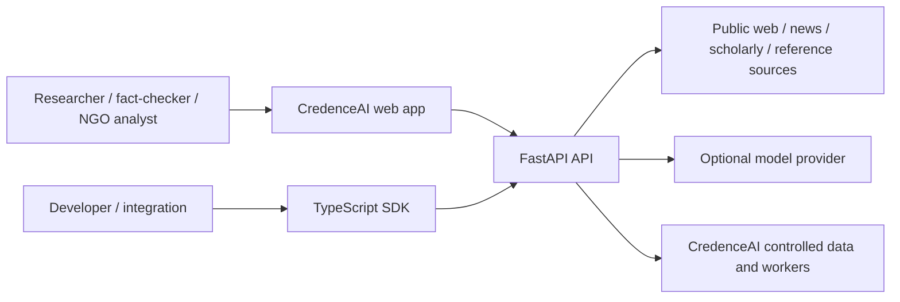
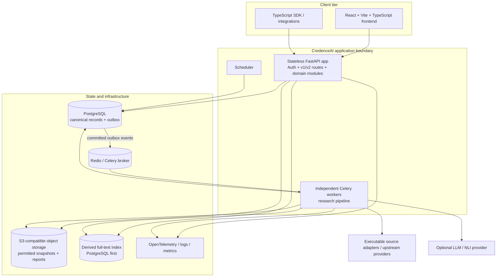
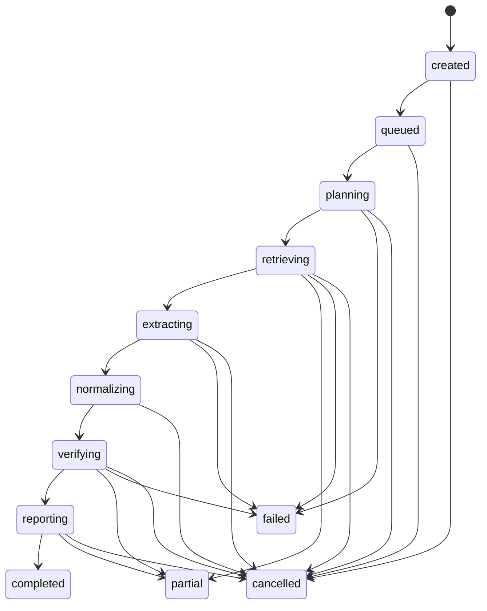
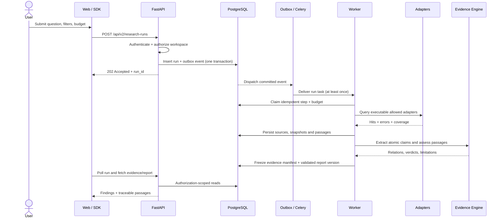
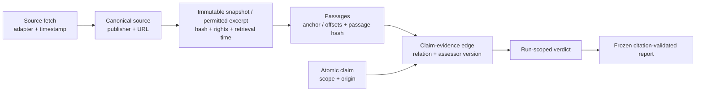
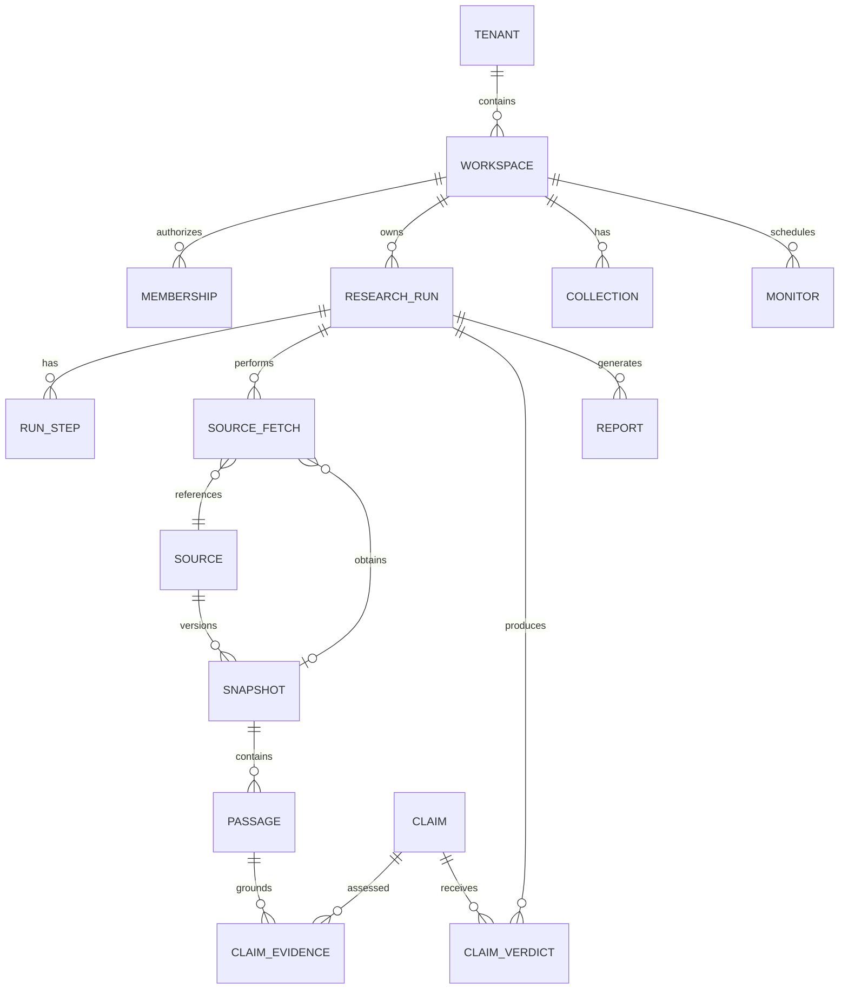
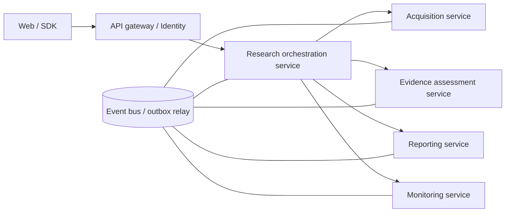

# CredenceAI 2.0 — System Architecture

> **Architecture status:** Proposed target architecture, not a claim that all components are deployed.  
> **Version:** 1.0  
> **Date:** 14 October 2026  
> **Source of requirements:** `project (3).md` — CredenceAI project definition v2.0  
> **Primary architectural style:** **Modular monolith with independently deployed durable workers**  
> **Evolution option:** Extract selected microservices only after measured scaling or isolation needs.

## 1. Executive decision

CredenceAI 2.0 should **remain a modular monolith**, rather than introduce a fleet of microservices at launch. A FastAPI application exposes versioned APIs and owns domain modules behind explicit interfaces. PostgreSQL remains the system of record. A transactional outbox, Redis/Celery queue, independently deployed workers and scheduler handle long-running research tasks. S3-compatible object storage retains rights-permitted snapshots and report artifacts. The React/TypeScript application and TypeScript SDK use the same API contracts.

This choice preserves the existing MVP's technology direction, reduces operational overhead for a free-first product, and supports the core requirement: **traceable claim-to-passage evidence**, not an illusion of verified truth. Microservice extraction is an *optional future deployment topology*, not a current functional requirement.

### 1.1 Architectural priorities

1. **Correctness and provenance:** every material report assertion has an authorized frozen passage reference or an explicit uncertainty/abstention statement.
2. **Isolation:** all private data, indexes, caches, results and exports are scoped to the server-derived tenant/workspace authorization context.
3. **Durability:** long-running research survives HTTP restarts and worker retries without duplicate results.
4. **Provider honesty:** source selection uses only enabled, executable, policy-compatible adapters; failures and skipped sources remain visible.
5. **Low operational burden:** avoid Kafka, a graph database, early microservices or mandatory paid sources until justified.
6. **Incremental migration:** keep v1 API behavior and historic research artifacts during the v2 rollout.

## 2. Scope and status

| Area | Existing MVP (reported / partially reviewed) | Proposed v2 target |
|---|---|---|
| API / frontend | FastAPI, React/TypeScript, TypeScript SDK | Versioned v2 evidence and research resources alongside v1 |
| Research | Job processing, search adapters, scoring, deduplication | Durable `research_run` lifecycle and capability-aware adapter execution |
| Evidence | Source/quality scoring and transient evidence graph | Immutable permitted snapshots, passages, atomic claims, evidence relations and run-scoped verdicts |
| Reports | AI synthesis | Frozen, citation-validated, human-reviewable reports |
| Access control | Existing identity / API mechanisms | Mandatory workspace policy across SQL, search, cache and exports |
| Async execution | Existing job dispatch/worker components | Transactional outbox, idempotent Celery tasks, recovery and cancellation |
| Monitoring | Existing monitors and collections | Reproducible reruns with evidence deltas and frozen history |

**Status caveat:** The project definition explicitly characterizes existing capabilities as reported and observations as sampled, not a complete production audit. The v2 items above are requirements and design proposals.

## 3. Context and container architecture

### 3.1 System context



External sources and model outputs are **untrusted**. Their data cannot change system instructions, tool privileges or workspace access. Providers operate only under permitted API, robots, license, rate-limit and storage conditions.

### 3.2 Recommended container diagram



**Outbox publishing detail:** an outbox dispatcher (part of an application/worker process) reads committed events from PostgreSQL and publishes them to Celery. The diagram simplifies this as `PG → Redis`; the database does not directly publish messages. A queue is a delivery mechanism; PostgreSQL remains authoritative for the run state.

### 3.3 Why modular monolith, not microservices now?

| Decision dimension | Modular monolith + workers (selected) | Microservices (deferred) |
|---|---|---|
| Team/deployment complexity | One API codebase and a small number of deployable process types | Multiple deployments, discovery, network calls and versioned inter-service APIs |
| Transactions | Strong transactional consistency for run metadata, ACL and outbox | Cross-service consistency requires sagas / events |
| Evidence correctness | Shared typed domain contracts; easier end-to-end citation enforcement | Risk of contracts drifting across services |
| Scaling | API and workers scale independently; per-task worker concurrency | Fine-grained per-service scale if proven necessary |
| Failure isolation | Worker process separation and bounded provider calls | Stronger service-level boundaries at greater operational cost |
| Launch suitability | Matches free-first and pilot scope | Premature for initial release |

The application should still enforce **logical boundaries** and publish internal interfaces so later extraction does not require rewriting the business model.

## 4. Module decomposition and ownership

| Module | Owns | Key interface / rule |
|---|---|---|
| Identity & Access | Tenants, users, memberships, roles, API keys, `AuthContext` | Every private resource access is workspace-authorized |
| Research Runs | Run creation, modes, budgets, state machine, steps, outbox | Idempotent creation and safe state transitions |
| Source Intelligence | Adapter manifests/registry, routing, coverage and source health | Only enabled and executable adapters are dispatched |
| Acquisition | Policy-gated HTTP fetch, rate limits, extraction, permitted storage | SSRF/redirect protections; rights-aware retention |
| Content & Retrieval | Canonical sources, snapshots, normalization, dedupe, passages, lineage and indexes | Preserve stable anchors and source independence |
| Evidence Engine | Atomic claims, claim-passage relation, scoped verdict, human reviews | Retrieval ranking is not factual confidence |
| Reports | Evidence-bound generation, citation gate, manifest/version, export | Reject or revise unsupported material statements |
| Monitoring | Scheduled reruns, evidence deltas, collections | Never silently overwrite old reports |
| Operations | Auditing, metrics, distributed tracing, quotas, recovery | No secrets or full sensitive content in telemetry |

**Boundaries:** API routes call application services; application services call typed repository/provider interfaces. Network fetching must stay outside request-serving handlers for long-running runs. Avoid direct imports between modules' persistence internals.

### 4.1 Suggested repository structure (refactoring target)

```text
backend/src/app/
  api/v1/                  # Legacy compatibility
  api/v2/                  # Research, claims, evidence, reports, reviews
  identity/                # AuthContext, RBAC, workspace policy
  research/                # Runs, step state, budgets, planning
  sources/                 # Adapter protocol, manifests, source router
  acquisition/             # HTTP policy, extraction, rights-aware storage
  content/                 # Dedupe, snapshot, passage, lineage, indexes
  evidence/                # Claims, relations, verdicts, review
  reporting/               # Citation-validated frozen outputs
  monitoring/              # Scheduled reruns and deltas
  infrastructure/          # DB, outbox, broker, object store, telemetry
  models/                  # Persistence models and migration helpers
frontend/                   # React evidence research workspace
sdk/                        # Versioned TypeScript API types
```

This is a **target layout**, not a statement that these paths presently exist.

## 5. Research lifecycle and execution

### 5.1 Run state machine



`timed_out` is also a valid terminal outcome from any active stage. `partial` means a bounded investigation produced usable artifacts but encountered coverage gaps, provider failures or uncompleted steps; it must not masquerade as `completed`.

### 5.2 End-to-end sequence



### 5.3 Operational guarantees

- **At-least-once delivery:** tasks may repeat; handlers use `(run_id, step_key, input_version)` idempotency keys and database uniqueness constraints.
- **Transactional outbox:** create the research run and outbox record together; dispatch only after commit.
- **Recovery:** persist attempts, leases, checkpoints and typed errors; reconcile orphaned/stalled tasks.
- **Bounded work:** enforce time, provider, source, page, byte and model-token/cost limits per run.
- **Backpressure:** provider-specific rate limiting, bounded fan-out and worker concurrency.
- **Cancellation:** check cancellation between steps and before expensive network/model actions.
- **Failure visibility:** retain skipped adapters, provider errors and unresolved gaps in the results and final report.
- **No HTTP-bound research work:** production long-running operations execute in independent workers.

## 6. Source discovery, acquisition and provenance

### 6.1 Adapter model

Each source adapter publishes a manifest: ID/version, `enabled`, `executable`, source class, supported languages and verticals, capabilities (metadata/full text/historical), timeouts, rate limits, cost class and legal constraints. A typed `search(request)` returns normalized hits, fetch time, latency, raw payload reference when allowed, errors and coverage notes.

**Candidate sources:** SearXNG and DuckDuckGo (web); Wikipedia and Wikidata (reference); GDELT (news discovery); OpenAlex, Crossref and arXiv (scholarly discovery); Common Crawl (permissible historical retrieval). These are **candidates**, not guaranteed live dependencies. A metadata index or news aggregator is not itself independent corroboration.

### 6.2 Acquisition controls

Allow HTTP(S) only. Validate DNS and connect-time destination IPs; block loopback, private/link-local, reserved and cloud-metadata addresses; re-check redirects and defend against DNS rebinding. Enforce robots/terms, domain throttling, MIME and byte ceilings, decompression safety, and content extraction isolation. Store full text only when permitted; otherwise retain compliant excerpts, metadata and stable references.

### 6.3 Stable evidence lineage



Keep publication dates distinct from retrieval times. Record original publisher, canonical URL, extraction version, content hash, language, license/retention terms and original/syndicated lineage where available. A citation link resolving successfully **does not alone establish** that its passage supports a claim.

## 7. Evidence and reporting architecture

### 7.1 Claim model

A claim carries text/proposition, subject, predicate, object/value, units, location, population, temporal scope, conditions and origin (`user_submitted` vs `source_extracted`). Claim assessment must account for mismatched geography, time, quantities or baselines.

### 7.2 Claim-to-passage relation

The `claim_evidence` edge links `claim_id` to `passage_id` and stores a relation (`supports`, `contradicts`, `mentions`, `irrelevant`, `uncertain`), assessor/rule/model version, reasoning, scope checks, independence group and human review history. Optional models **propose** relations; deterministic validators check passage existence/authorization and quote/structured consistency.

### 7.3 Run-scoped verdicts

| Verdict | Interpretation |
|---|---|
| `supported` | Supported by the examined, scoped evidence without unresolved material conflict |
| `disputed` | Relevant material evidence conflicts |
| `insufficient_evidence` | Accessible evidence does not justify a defensible conclusion |
| `not_assessed` | Assessment was not completed or claim was outside run scope/budget |

Never present retrieval rank, quality heuristics or an uncalibrated score as a probability that a claim is true. Missing evidence does not establish falsehood.

### 7.4 Report generation gate

1. Freeze a run-specific set of authorized passages and claim assessments.
2. Generate a structured report draft based on that set.
3. Extract each material assertion from the draft.
4. Require valid references to frozen `passage_id` records.
5. Validate quote spans, cited relations, numeric/temporal compatibility and scope.
6. Block/revise unsupported assertions; visibly retain uncertainty and conflicting evidence.
7. Persist immutable report version, manifest hash, evaluator/config versions and reviewer history.

Human reviewers can annotate assessments but cannot silently rewrite the original captured evidence.

## 8. Data architecture

**Primary store:** PostgreSQL. **Local development/testing option:** SQLite with documented differences. **Blobs:** S3-compatible object store. **Search:** PostgreSQL full-text search first; optional pgvector/OpenSearch only if benchmarks demonstrate a net benefit. Derived indexes and caches must be rebuildable, authorization-filtered projections.

### 8.1 Logical ER diagram



### 8.2 Core tables and requirements

| Data object | Essential attributes / invariants |
|---|---|
| `tenants`, `workspaces`, `memberships` | Tenant identifier, membership roles and uniqueness |
| `research_runs`, `run_steps` | Workspace, question, filters/mode/budget, config hash, attempts, idempotency, status |
| `source_fetches`, `sources` | Adapter request/coverage, canonical URL, publisher, rights, source class |
| `snapshots`, `passages` | Immutable snapshot ID, hash, timestamps, storage ref, rights, stable passage anchor |
| `claims`, `claim_evidence`, `claim_verdicts` | Scoped proposition, passage relation, assessor version/review, run verdict |
| `reports` | Run ID, version, frozen evidence manifest hash, output ref, status/reviewer |
| `outbox_events`, `audit_events` | Dispatch record; minimal actor/action/resource/timestamp for audit |
| `collections`, `monitors` | Workspace-owned saved research and repeatable scheduled runs |

Maintain backward-compatible migrations for existing `users`, `jobs`, `normalized_results`, `quality_scores`, `collections`, `monitors` and `api_keys`; do not discard historical jobs.

### 8.3 Multi-tenant access model

- Derive `AuthContext` from the authenticated session or scoped API key, **not** from arbitrary request parameters.
- Require workspace/tenant scope in repository queries, index filters, cache lookups, snapshot reads and signed export generation.
- Consider PostgreSQL row-level security as defense in depth; it does not replace service-side authorization.
- Isolate rights-cleared shared public corpora from private workspace indexes.
- Include permissions, data rights, config/evaluator versions and freshness in cache keys; recheck authorization on cache hits.
- Define retention, deletion and backup propagation rules before enabling shared or permanent exports.

## 9. API and integration architecture

Preserve v1 clients where possible. Add documented v2 resources:

```http
POST /api/v2/research-runs
GET  /api/v2/research-runs/{run_id}
GET  /api/v2/research-runs/{run_id}/sources
GET  /api/v2/research-runs/{run_id}/claims
GET  /api/v2/research-runs/{run_id}/claims/{claim_id}/evidence
GET  /api/v2/research-runs/{run_id}/reports/{version}
POST /api/v2/research-runs/{run_id}/reviews
POST /api/v2/research-runs/{run_id}/cancel
POST /api/v2/monitors
GET  /api/v2/monitors/{monitor_id}/deltas
```

**Contract conventions:** asynchronous creation returns a run identifier and status endpoint; 401/403/404 semantics are explicit; list endpoints paginate with enforced limits; typed errors include retry guidance when safe; idempotency keys protect repeat creation; polling supports UI progress initially (SSE may follow). The TypeScript SDK exports typed run, evidence, report and review models.

## 10. UI architecture

The React SPA includes: research home (modes/filters/budgets), run progress (real stages and source coverage), findings board (claims by verdict), evidence inspector (passage, publisher, relation, lineage and review), source explorer, report workspace (versions/export/approval), monitors and collections, and workspace settings.

The evidence inspector must provide the passage-level provenance used to justify or challenge each material finding. A summary view without accessible supporting passages does **not** satisfy the v2 evidence contract.

## 11. Security and model safety

| Threat | Architectural control |
|---|---|
| Cross-tenant access | AuthContext enforcement in SQL, indexes, caches, exports, worker inputs and signed blob retrieval |
| SSRF / hostile fetch URLs | DNS plus connect-time IP validation, redirect rechecks, reserved-range blocking, egress controls |
| Provider abuse / outages | Quotas, rate limits, bounded concurrency, retries, partial result semantics |
| Prompt injection | Retrieved text is data only; strict tool schemas, fixed permissions and deterministic output checks |
| Copyright / retention violations | Source terms/robots checks, rights-aware storage and retention metadata |
| Duplicate or lost work | Transactional outbox, idempotent steps, leases, reconciliation |
| Forged citation / unsupported AI prose | Passage references, frozen evidence manifests, validation before publication |
| Token leakage | Hashed/rotatable keys, secret manager, TLS, least-privilege workers, safe structured logs |

This platform is a research aid, not a certified medical, legal or financial decision service. High-impact and unresolved claims require human review.

## 12. Deployment and operational topology

### 12.1 Deployment model

```mermaid
flowchart TB
  USER[Browser / SDK] --> FE[Vercel static frontend]
  FE --> API[Stateless FastAPI replicas]
  API --> DB[(Managed PostgreSQL)]
  API --> B[(Redis / Celery)]
  B --> W[Dedicated worker replica(s)]
  CRON[Scheduler] --> DB
  W --> DB
  W --> STORE[(S3-compatible storage)]
  API --> STORE
  W --> INTERNET[Allowlisted / policy-gated sources]
  API --> TELEMETRY[Traces / metrics / logging]
  W --> TELEMETRY
```

Application and worker deployments may use separate containers/images built from one repository. Autoscale API according to request load and workers according to queue age, processing latency, budgets and provider rate limits. Protect database/queue/blob credentials by role and environment. Avoid deploying full long-running research inside Vercel request functions.

### 12.2 Observability

Correlate traces across API → outbox → dispatcher → worker → adapter → evaluator → report using `run_id`, `workspace_id`, step ID and trace ID. Collect queue age, stage p50/p95 latency, success/partial/failure proportions, provider coverage and errors, retries, tokens, cost/run, storage consumption, citation validity, relation accuracy and human corrections. Audit reviewer and policy-sensitive actions separately from debugging telemetry.

### 12.3 Backup, recovery and index rebuilding

Back up PostgreSQL and permitted object-storage data with documented retention, recovery objectives and restoration tests. Rebuild retrieval indexes from canonical records. Requeue orphaned steps from database state instead of trusting queue memory. A restored report must still reference the same frozen manifest and rights-permitted passages.

## 13. Microservices evolution path (not the initial architecture)

### 13.1 Triggers for extracting a service

Consider extraction only after observable evidence: a sustained need to scale ingestion/verification independently beyond worker pools; markedly different security/egress zones; independent teams with stable contracts; or an isolation/SLA target that process boundaries cannot meet. Benchmark latency, deployment overhead, data consistency and operations cost before proceeding.

### 13.2 Possible future boundaries



**Important:** This is illustrative only. A future distributed design requires explicit ownership of data, versioned inter-service contracts, event schemas, idempotency and eventual-consistency rules. Do not simply put each current Python folder behind HTTP; such a change adds network failure modes without delivering meaningful service boundaries.

### 13.3 Safest extraction order

1. Strengthen internal module interfaces and domain ownership while remaining monolithic.
2. Isolate egress-restricted acquisition workers if distinct network/security controls are necessary.
3. Split resource-intensive evidence/model execution if scaling and model-provider controls require it.
4. Extract monitoring/reporting only when independent ownership and scale justify distributed transactions and version contracts.
5. Keep centralized policy enforcement and complete end-to-end provenance even if physical services separate.

## 14. Migration plan and release gates

| Phase | Indicative weeks | Architectural changes | Exit criteria |
|---|---:|---|---|
| 0. Secure and clarify | 1–2 | Tenant scope in all retrieval/cache paths, remove deceptive confidence display, auth tests | No known cross-workspace retrieval in adversarial tested paths |
| 1. Reliable source execution | 3–4 | Executable adapter registry, real routing, coverage notes, outbox + durable workers | Three executable source classes demonstrated in suitable integration tests |
| 2. Evidence foundation | 5–8 | Rights-aware snapshots, passages, claims, relation edges, citation gate, inspector | Every material report assertion has a valid passage or explicit abstention |
| 3. Evaluation and pilots | 9–12 | Human-labeled evaluation, lineage checks, monitoring deltas, operational benchmarks | Evidence quality, cost and researcher value measured on actual cases |

These are **indicative planning windows**, not committed dates or proof of shipping.

## 15. Verification strategy and proposed quality gates

- **Security:** zero known cross-tenant retrieval in adversarial regression tests; SSRF and injection scenarios covered.
- **Citation integrity:** 100% of report citation IDs resolve to authorized passages within a frozen run.
- **Passage support:** target at least 95% support of material cited statements in held-out human review.
- **Unsupported material assertions:** target at most 5% in reviewed generated reports for the initial release.
- **Coverage honesty:** report skipped, unhealthy and failed providers; do not imply unavailable sources were queried.
- **Reliability:** validate retries, cancellation, timeout, worker loss, partial runs and indexing rebuilds.
- **Reproducibility:** persist input snapshots, manifests, evaluator/config versions and logged nondeterminism.
- **Economics:** enforce run budgets and report cost-per-run, queue metrics and correction rates.

Build a proposed 100–200-question labeled benchmark including ordinary, disputed, stale, unknown, temporally/geographically ambiguous, syndicated and malicious-source cases. These are **targets**, not established production performance.

## 16. Architecture decision records (ADRs)

| ID | Decision | Status |
|---|---|---|
| ADR-001 | Modular monolith plus durable independent workers, not microservices at launch | Proposed / selected target |
| ADR-002 | PostgreSQL authoritative; search indexes and caches rebuildable | Proposed / selected target |
| ADR-003 | Relational claim-to-passage records before graph database | Proposed / selected target |
| ADR-004 | Ranking heuristics must not imply calibrated truth probability | Required product principle |
| ADR-005 | Run only enabled, executable, policy-compatible adapters | Required product principle |
| ADR-006 | Require authorization scope across retrieval, cache, reports and exports | Required security principle |
| ADR-007 | Treat external text/model output as untrusted; deterministic checks remain authoritative | Required security principle |
| ADR-008 | Reports reference a frozen versioned evidence manifest | Required evidence principle |
| ADR-009 | Add vector search / specialized stores only after measured improvement | Deferred optimization |
| ADR-010 | Preserve v1 API compatibility throughout migration | Migration constraint |

## 17. Open technical decisions

The project definition does not finalize the following; resolve through implementation design and pilot measurement, without asserting unsupported figures:

- Specific identity provider/OIDC deployment and workspace role matrix.
- Cloud vendor for API, database, workers, broker and object store; secrets and egress-control mechanism.
- Object retention periods, permissible excerpt limits and deletion SLAs per upstream source.
- Concrete worker concurrency, timeout/budget defaults and queue sizing per mode.
- Human reviewer assignment/approval policy and elevated-review criteria.
- Monitoring schedules, missed-run handling and notification channels.
- Recovery point/time targets, production SLAs and operational on-call ownership.
- Whether PostgreSQL row-level security is enabled in addition to application-layer authorization.

## 18. Architecture definition of done

- [ ] Workspaces isolate all private data, caches, indexes, API outputs and exported artifacts.
- [ ] Source router actually invokes eligible adapters and exposes provider coverage/errors.
- [ ] Research jobs survive retry and worker loss without duplicate final artifacts.
- [ ] Every material factual report statement has validated frozen passage evidence or explicit abstention.
- [ ] Source lineage separates original reporting from syndication and aggregators.
- [ ] Evidence inspector exposes relation, provenance, timestamp and reviewer state.
- [ ] Reports and manifests are versioned, immutable after freeze, and re-openable.
- [ ] Crawl/SSRF/rights/prompt-injection test suites pass for declared deployment paths.
- [ ] v1 clients retain supported behavior during the v2 rollout.
- [ ] Benchmarked quality, cost and target-user research value are documented.

---

## 19. Monorepo repository layout & directory map

CredenceAI is structured as an integrated monorepo ensuring tight contracts between backend services, the frontend application, and client SDKs:

```text
CredenceAI/
├── backend/                  # FastAPI service & Celery worker
│   ├── Dockerfile            # Container definition (production Render image)
│   ├── alembic.ini           # Migration configuration
│   ├── migrations/versions/  # Forward/idempotent schema migrations
│   ├── src/app/
│   │   ├── main.py           # Application entrypoint & lifespan
│   │   ├── config.py         # Pydantic Settings
│   │   ├── models.py         # SQLAlchemy ORM schemas
│   │   ├── api/v2/           # Epistemic research run routes
│   │   ├── identity/         # Multi-tenant AuthContext & guest access
│   │   ├── services/         # Evidence engine, keepalive, crawler, synthesis
│   │   └── worker.py         # Celery task definitions
│   └── tests/                # Unit, property, and integration test suite
├── frontend/                 # React 19 + Vite + Tailwind SPA
│   ├── vercel.json           # Vercel deployment & /api rewrite rules
│   ├── src/
│   │   ├── pages/app/        # ResearchWorkspace, SearchApp, Dashboard, Monitors
│   │   ├── lib/              # api.ts, researchFallback.ts (zero-downtime engine)
│   │   ├── components/       # ThemeToggle (Dark, Light, Beige), ApiKeepAlive
│   │   └── index.css         # 3-Palette design tokens & brutalist typography
├── sdk/                      # Open-source TypeScript SDK (@credenceai/sdk)
│   ├── src/                  # CredenceAIClient, blocking run(), types
│   └── tsup.config.ts        # ESM + CJS bundle output
├── scripts/                  # Operations & automation
│   ├── dev.ps1               # Local development launcher
│   ├── prod-check.ps1        # Pre-flight production validation
│   ├── keepalive_ping.py     # Standalone 40-45s keep-alive runner
│   └── verify-deployment.ps1 # Cloud smoke test script
├── docs/                     # Canonical documentation suite
│   ├── CredenceAI 2.0.md     # Main Project Master Guide
│   ├── brd.md                # Business Requirements Document
│   ├── srs.md                # Software Requirements Specification
│   ├── architecture.md       # Technical Architecture & Operations (this document)
│   └── checklist.md          # 100% Completion & Release Acceptance Checklist
├── render.yaml               # Render Infrastructure Blueprint
└── README.md                 # Public project overview & quickstart
```

---

## 20. Environment variable reference & configuration catalog

| Variable | Type | Default | Mode | Purpose |
|---|---|---|---|---|
| `APP_ENV` | `string` | `local` | All | Application environment: `local`, `development`, `production`. |
| `DATABASE_URL` | `string` | `sqlite:///./credenceai.db` | All | SQLAlchemy connection string (Neon Postgres in production). |
| `REDIS_URL` | `string` | `redis://localhost:6379/0` | All | Celery message broker & cache (`rediss://` on Upstash). |
| `REDIS_SSL_CERT_REQS` | `string` | `CERT_REQUIRED` | Prod | Upstash Redis SSL parameter. |
| `JWT_SECRET` | `string` | — | Prod | Secret key (min 16 chars) for signing session tokens. |
| `CORS_ALLOWED_ORIGINS` | `json` | `["http://localhost:3000"]` | All | Allowed frontend origins for cross-origin API calls. |
| `CELERY_ALWAYS_EAGER` | `boolean` | `true` | Dev/Free | Run Celery tasks synchronously inline in API process. |
| `MOCK_SERVICES` | `boolean` | `true` (dev) | All | Fallback mocks for external APIs (`false` in production). |
| `ENABLE_API_KEY_AUTH` | `boolean` | `true` | Prod | Require `X-API-Key` or Bearer JWT on protected endpoints. |
| `SELF_KEEPALIVE_ENABLED` | `boolean` | `true` | Prod | Enable automated background keep-alive ping loop. |
| `SELF_KEEPALIVE_INTERVAL_SEC` | `int` | `42` | Prod | Randomized 40–45s interval between keep-alive pings. |
| `API_PUBLIC_URL` | `string` | `https://credenceai-api.onrender.com` | Prod | Public backend URL for self-ping keep-alive. |
| `GOOGLE_CLIENT_ID` | `string` | — | Prod | Google Cloud OAuth 2.0 Client ID. |
| `GOOGLE_CLIENT_SECRET` | `string` | — | Prod | Google Cloud OAuth 2.0 Client Secret. |
| `GOOGLE_REDIRECT_URI` | `string` | — | Prod | `https://<frontend>/auth/google/callback`. |
| `GITHUB_CLIENT_ID` | `string` | — | Prod | GitHub OAuth Application Client ID. |
| `GITHUB_CLIENT_SECRET` | `string` | — | Prod | GitHub OAuth Application Client Secret. |
| `GITHUB_REDIRECT_URI` | `string` | — | Prod | `https://<frontend>/auth/github/callback`. |

---

## 21. Production split deployment runbook (Vercel + Render + Neon + Upstash)

### 21.1 Free-Tier Cloud Architecture
- **Frontend:** Hosted on Vercel Edge Network (`https://credence-ai-gamma.vercel.app`).
  - `vercel.json` proxies `/api/:path*` to `https://credenceai-api.onrender.com/api/:path*`.
  - Zero CORS overhead and zero exposed Render URLs to end-user browsers.
- **Backend:** Hosted on Render Free Web Service (`credenceai-api`).
  - Containerized FastAPI service defined in `backend/Dockerfile`.
  - Free plan uses `CELERY_ALWAYS_EAGER=true` with FastAPI background tasks.
- **Database:** Serverless PostgreSQL on Neon (`DATABASE_URL=postgresql://...`).
- **Cache / Broker:** Upstash Serverless Redis (`REDIS_URL=rediss://...` with `ssl_cert_reqs=CERT_REQUIRED`).

### 21.2 Deployment Verification Script
Execute from PowerShell to smoke-test live cloud infrastructure:
```powershell
.\scripts\verify-deployment.ps1 -ApiUrl "https://credenceai-api.onrender.com" -ApiKey "cred_sk_YOUR_KEY"
```

---

## 22. OAuth setup & callback configuration

1. **Google Cloud Console:**
   - Authorized Javascript Origins: `https://credence-ai-gamma.vercel.app`.
   - Authorized Redirect URI: `https://credence-ai-gamma.vercel.app/auth/google/callback`.
2. **GitHub Developer Settings:**
   - Homepage URL: `https://credence-ai-gamma.vercel.app`.
   - Authorization Callback URL: `https://credence-ai-gamma.vercel.app/auth/github/callback`.
3. **Troubleshooting:**
   - `503 OAuth not configured`: Set `GOOGLE_*` or `GITHUB_*` env vars on Render dashboard and redeploy.
   - `redirect_uri_mismatch`: Ensure redirect URI matches exactly, including trailing slashes and HTTPS.

---

## 23. Automated 40–45s inactivity keep-alive engine

To overcome free-tier cloud platform idling (where containers spin down after 15 minutes of inactivity), CredenceAI implements a multi-layered keep-alive architecture:

1. **Backend Self-Keepalive Service (`self_keepalive.py`):**
   - Asynchronous daemon task initialized in `main.py` lifespan.
   - Sleeps for a randomized duration between **40 and 45 seconds** (`SELF_KEEPALIVE_INTERVAL_SEC: 42`).
   - Issues non-blocking HTTP GET requests to `${API_PUBLIC_URL}/api/health`.
2. **Frontend Inactivity Heartbeat (`ApiKeepAlive.tsx`):**
   - React component mounted at root of the web application.
   - Dispatches a lightweight ping to `/api/health` every 40,000–45,000 ms during active browser sessions.
3. **Standalone External Ping Script (`scripts/keepalive_ping.py`):**
   - Zero-dependency Python script designed for local CLI or cron execution.
   - Runs continuous randomized 40–45s ping loops with retry backoff and status logging:
     ```bash
     python scripts/keepalive_ping.py --url https://credenceai-api.onrender.com/api/health --interval 42
     ```
4. **Resilient In-Browser Fallback Engine (`researchFallback.ts`):**
   - If the backend is cold-starting or unreachable, the frontend seamlessly executes factual audits locally, ensuring zero-downtime exploration.

---

## 24. TypeScript SDK architecture (@credenceai/sdk)

The open-source `@credenceai/sdk` package provides clean TypeScript bindings:

```ts
import { CredenceAIClient } from "@credenceai/sdk";

const client = new CredenceAIClient({
  apiKey: process.env.CREDENCEAI_API_KEY!,
  baseUrl: "https://credence-ai-gamma.vercel.app",
});

// High-level blocking execution
const result = await client.run("Did clean energy investments surpass fossil fuels in 2024?");
console.log(result.status, result.data);
```

- **Authentication:** `X-API-Key: cred_sk_...` or Bearer JWT token.
- **Client Features:** Built-in exponential backoff retry, trace-ID preservation, client-side input validation, ESM/CJS dual-build outputs via `tsup`.

---

## 25. Day-2 operations, backups, and health monitoring

- **Health Endpoints:**
  - `GET /api/health`: Service liveness, version, and dependency check.
  - `GET /api/health/ready`: Kubernetes / Render readiness probe.
- **Postgres Backups:** Automated weekly `pg_dump` via GitHub Actions (`.github/workflows/backup.yml`). Manual backup:
  ```bash
  pg_dump "$DATABASE_URL" > backup_$(date +%Y%m%d).sql
  psql "$DATABASE_URL" < backup.sql
  ```
- **Rate Limiting:** Sliding-window rate limiter per IP / API key (default: 60 req/min for free users, 300 req/min for authenticated keys).

---

## 26. Testing strategy & benchmark validation

- **Unit & Property Tests:**
  - `pytest` test suite with `hypothesis` property-based testing in `backend/tests/`.
  - SQLite in-memory test runner: `DATABASE_URL=sqlite:///:memory: APP_ENV=local pytest -q`.
- **Frontend & SDK Verification:**
  - `npm run lint` (`tsc --noEmit`) and `vitest` for SDK contracts.
  - Playwright E2E browser test automation verifying end-to-end user workflows.

---

### References

- CredenceAI, *Project definition, product requirements, and architecture specification*, version 2.0, 14 October 2026.
- Existing repository: <https://github.com/Niruuu2005/CredenceAI>
- W3C PROV-O: <https://www.w3.org/TR/prov-o/>
- OWASP Top 10 for LLM Applications: <https://owasp.org/www-project-top-10-for-large-language-model-applications/>
- NIST AI Risk Management Framework: <https://www.nist.gov/publications/artificial-intelligence-risk-management-framework-generative-artificial-intelligence>
- OpenTelemetry: <https://opentelemetry.io/docs/>
